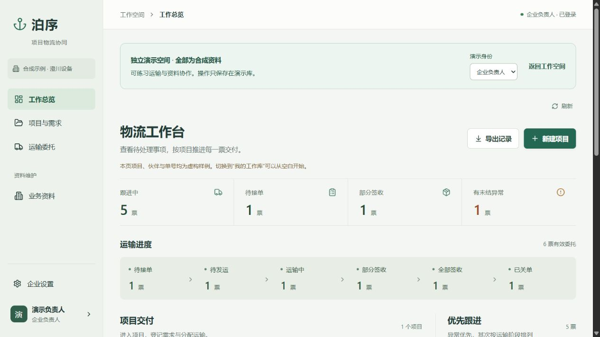
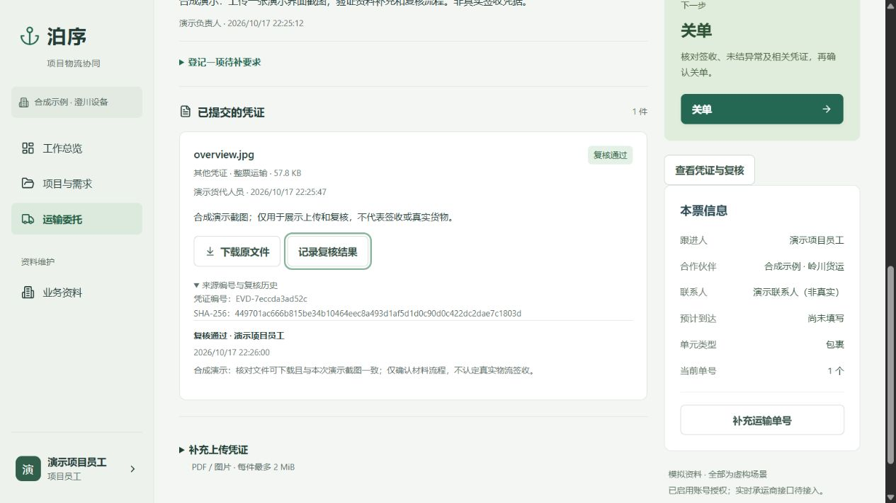

# 泊序｜企业项目物流协同原型

把分散的项目需求、运输委托和交付资料放到同一条可追溯的业务线上。项目员工、企业负责人及货代分别查看与维护获授权的内容。**这是本机作品展示版 v0.12，所有预置业务资料均为合成示例。**



## 三分钟了解项目

一个项目可能使用不同货代或国际快递。需求、单号、运输进度和交付资料如果只靠多人自由填写的表格汇总，很难可靠判断哪些票需要行动。泊序把业务事实拆为**项目 → 发运需求 → 运输委托 → 单件/集装箱 → 节点、异常、凭证与复核**，保留录入者、来源与操作记录。

演示路径：

1. **工作总览**：按待接单、待发运、运输中、部分签收、全部签收、已关单查看六类委托；异常优先跟进。
2. **项目与需求**：登记货物、起止地和期望到货日；同一需求可分批委托不同伙伴。
3. **运输委托**：货代接单、补单号与发运信息；企业员工按件签收、处理异常并关单。
4. **凭证与复核**：企业提出待补要求；获授权货代上传原件；员工记录复核结论。材料上传不会自动认定签收或推进运输状态。
5. **资料保全**：负责人可导出业务记录及建立包含附件字节的便携备份；空库恢复有校验。



## 本机运行

直接运行演示需要 **Windows 和 Python 3.12+**。首次安装 Python 依赖需要网络。仓库附带已编译的 `web/`；只有修改前端或重新构建时才需要 Node.js 22+ 和 pnpm 10。

```powershell
python -m venv .venv
.\.venv\Scripts\python.exe -m pip install -r requirements.txt
.\.venv\Scripts\python.exe scripts\serve.py --demo
```

打开 **http://127.0.0.1:8769/collaboration**。演示空间首次运行会自动生成六种运输阶段的合成订单，顶部可切换企业负责人、项目员工、货代人员。练习数据保存在被忽略的 `data/demo/`，重启后保留。

本机端口 8769 被占用时使用 `--port 8771`；想生成另一份全新演示资料，可加 `--fresh-demo`。新资料放在独立目录，不覆盖先前练习。用 `Ctrl+C` 停止当前服务。

需要修改前端时，在 `frontend/` 运行 `pnpm install --frozen-lockfile` 和 `pnpm build`，然后刷新浏览器。请以协同服务的 `/collaboration` 地址验证完整交互。

若要开一个空白工作空间，另开终端执行：

```powershell
.\.venv\Scripts\python.exe scripts\serve.py --work
```

工作空间默认在 **http://127.0.0.1:8768/collaboration**，首次由使用者设置负责人账号。它使用独立 `data/work/`；不要把工作库、日志或附件提交到公开仓库。服务只绑定本机回环地址。

## 技术与验证

前端为 React、TypeScript、Vite；后端为 FastAPI、SQLModel、Alembic。默认 SQLite；隔离验收曾在 PostgreSQL 上运行。权限按账号角色、项目及订单范围检查。附件存于私有目录，每次下载再次校验授权和 SHA-256。

```powershell
.\.venv\Scripts\python.exe scripts\check.py all
```

脚本在随机本机端口和独立合成数据库中检查业务、文件导入、附件及演示隔离；结果写入被忽略的 `.test-runs/`。本地整理版验收为业务 169、导入 130、附件 144、演示隔离 39 项断言通过；这是检查断言数，**不是独立业务场景数或生产覆盖率**。CI 工作流会在 Windows 新环境安装、构建并执行同一组检查。

## 范围与来源

- 已实现：项目/需求/分批委托、状态跟进、单件签收、异常、账号授权、CSV/XLSX 导入复核、附件、备份与空库恢复。
- 当前限制：本机试点；没有飞书实时同步、UPS/FedEx 接口、OCR/AI 提取、自动邀请、自助找回密码、病毒扫描或公网多租户部署。待补凭证属于协作提醒，没有独立责任人和期限，也不是强制关单条件。
- 早期海运到港提货模型位于 `reference/`，用于说明状态、期限和事件来源；当前展示主线是企业项目物流协同。
- 公开资料与第三方许可证见 [来源说明](THIRD_PARTY_NOTICES.md)；演示企业、人员、运输和附件均为合成资料。
- 产品问题与业务流程由项目作者提出并逐轮验收；实现过程中使用 Codex 辅助编程。此仓库展示的是经本机验证的原型，不能据此声称已在真实企业或真实货代上线。
- 页面主次与材料复核的设计选择见 [界面决策](docs/DESIGN-v012.md)；接口与数据边界见 [架构说明](docs/ARCHITECTURE.md)；检查记录见 [验证说明](docs/VALIDATION.md)。

## 许可

原创代码目前**仅供公开展示，未授予开源许可**；第三方资料保持各自许可证。详情见 [LICENSE](LICENSE)。
