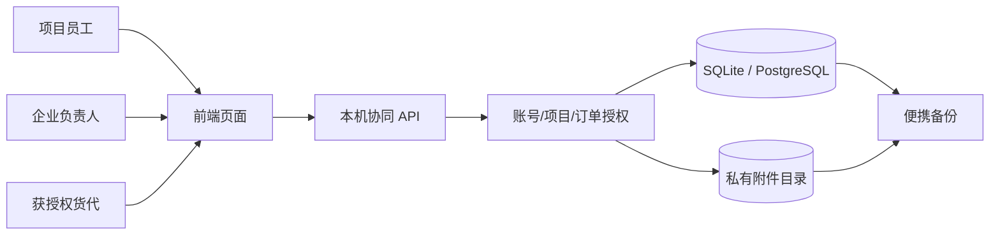

# 一票货的数据怎么连起来

项目提出需求后，才会产生一票或多票运输委托。单号、节点、异常、凭证都挂在具体委托上。这样回头看某个问题时，可以找到对应的项目、订单和操作人。

数据库用项目、发运需求、运输委托和运输单元串起业务。单号、运输动作、异常、凭证及复核历史都关联到委托；系统不会从自由备注里猜出这些字段。CSV/XLSX 导入也要先预览、映射、逐行确认，保存草稿后才写入正式业务记录。原始文件和来源关联会保留。

演示和工作空间各用自己的数据库与附件目录。演示身份只对合成资料生效；工作空间首次使用时要建立负责人账号。成员每次读取项目或订单，服务端都会检查授权。菜单里看不到某个入口，也不能算作权限控制。

附件保存原文件，并限制格式与大小。上传、复核和业务签收是三个独立动作。下载和备份读取会核对大小与 SHA-256；恢复只允许写入空库，不能直接覆盖现有工作资料。文件限制和故障处理见 [凭证说明](EVIDENCE-v011.md)。
