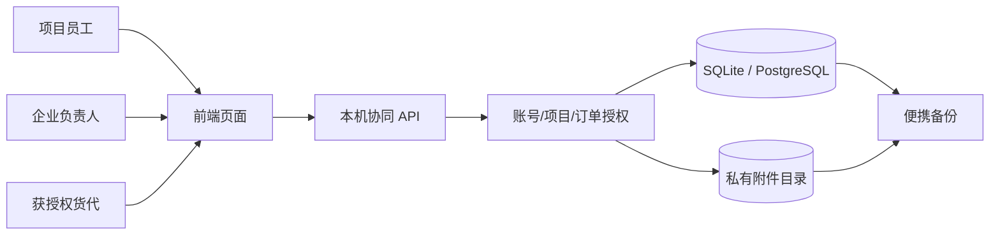

# 数据链与权限边界

核心业务键依次为项目、发运需求、运输委托和运输单元。单号、运输动作、异常、凭证及复核历史都关联到委托；字段不是从备注自动猜出。CSV/XLSX 导入先预览、映射和逐行确认，保存草稿后才写入业务对象。原始导入文件和来源关联保留。

演示与工作模式分别使用不同数据库与附件目录。演示身份只作用于合成库。工作模式需要首次建立负责人账号；成员能否查看某个项目/订单取决于服务端授权，隐藏页面入口并不代替权限检查。

附件为限定格式、大小的原文件；上传、复核与业务签收是不同动作。下载和备份读取会验证大小与 SHA-256。备份恢复只允许空目标，不支持直接覆盖现有工作库。细节与故障边界见 [附件说明](EVIDENCE-v011.md)。
