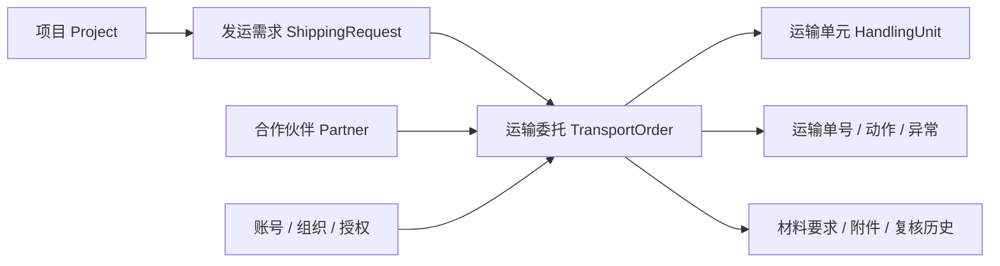

# 工程接手与维护基线

这份文件供接手开发的人阅读，也供产品负责人检查交付范围。以仓库代码和验证结果为准；写在这里的后续工作不表示已经完成。

## 产品边界

当前主线是一个企业的项目物流协同：项目需求 → 分批运输委托 → 获授权伙伴更新 → 企业按运输单元签收 → 异常与材料复核 → 关单。

Windows 使用版提供合成演示和独立工作空间。使用者不需要开发环境，但服务只开放本机。不同电脑各有一份资料；当前没有共享服务器、跨企业公网访问、多租户 SaaS、飞书同步或承运商自动查询。EXE 的分发不改变这些业务边界。

## 功能台账

| 能力 | 入口 | 当前边界 |
| --- | --- | --- |
| 项目、需求、分批委托 | 项目与需求 / 单票 | 人工结构化登记；不从自由备注猜业务状态 |
| 运输执行、签收、异常 | 运输委托 / 单票 | 企业与伙伴按授权操作；状态由动作与运输单元计算 |
| 伙伴与成员授权 | 业务资料 / 企业设置 | 伙伴身份还需绑定伙伴和具体委托授权 |
| CSV/XLSX 导入 | 业务资料 → 导入 | 预览、映射、逐行确认后写入 |
| 附件与材料复核 | 单票 → 凭证 | 上传、复核、签收独立；无病毒扫描 |
| 完整备份与恢复 | 企业设置 / 启动器 | 账号、资料及附件一起备份；恢复只接受空库 |
| Windows 应用分发 | 官方 Release 使用包 | x64、未签名、本机运行；macOS/Linux 无发行物 |

## 数据关系与权限

项目编号、需求数量、委托和运输单元不可混作一个实体。单号是委托的业务资料，备注不自动触发状态变化。附件元数据在数据库，文件在配套私有目录；单独复制数据库不能替代包含附件的完整备份。

| 身份 | 可访问范围 | 关键限制 |
| --- | --- | --- |
| 企业负责人 owner | 当前本机企业空间 | 管理伙伴、成员、授权和备份；当前没有跨租户边界 |
| 项目员工 employee | 获授权项目及其委托 | 无负责人管理权限；可按规则执行签收、异常和复核 |
| 伙伴 partner | 绑定伙伴且逐票授权的委托 | 接单、发运、预计、自己的跟进与允许的材料操作；不能替企业签收关单；内部备注受过滤 |

读取、导出、附件下载和业务动作都必须由服务端授权。前端隐藏入口仅是界面安排。权限源文件是 `backend/collab_policy.py`，材料权限另见 `backend/collab_evidence.py`。

## 模块地图

| 文件或目录 | 职责 | 修改时重点复核 |
| --- | --- | --- |
| `scripts/desktop_app.py` | 图形启动、浏览器入口、备份文件选择 | 不直接包含业务或密码校验规则 |
| `scripts/desktop_runtime.py` | 路径、端口、模式配置、实例锁、服务生命周期 | 演示/工作隔离；打包进程父子关系；不能自动接入外部数据库 |
| `scripts/serve.py` | 开发者源码启动入口 | 与桌面入口共用模式环境配置；工作源码入口保留 PostgreSQL 配置 |
| `backend/collaboration.py` | HTTP 入口、认证依赖和调用编排 | 每个受保护接口都经过授权；仍需继续按领域拆分 |
| `backend/project_logistics.py` | 项目运输业务命令、查询和状态 | 幂等编号、版本检查、数量、状态转换；仍含历史入口 |
| `backend/collab_auth.py` / `collab_policy.py` | 会话、密码、资源访问 | 权限改变后的旧会话、越权、角色边界 |
| `backend/collab_import.py` / `collab_evidence.py` | 导入和材料协作 | 草稿确认、文件范围、摘要及复核历史 |
| `backend/collab_database.py` / `collab_backup.py` | 迁移与完整备份 | 修改结构必须有迁移；禁止覆盖已有资料恢复 |
| `frontend/src/collaboration-api.ts` | 账号、空间接口类型与请求头 | 与服务端响应一致；业务面板完整类型化仍未完成 |
| `frontend/src/ProjectLogistics.tsx` | 工作总览、项目、委托、表单 | 文件职责偏多，需要逐步拆分并保持交互一致 |
| `tests/` | 隔离 HTTP 业务回归 | 使用合成数据和随机端口；不接入用户工作库 |
| `scripts/check_desktop.py` | 从源码或最终 EXE 检查交付 | 初始化、持久化、隔离、端口、重复启动和恢复 |

唯一应用版本位于 `backend/version.py`。数据库版本由 `migrations/versions/` 管理，二者不能互相替代。

## 已知维护债及顺序

1. **高优先：**继续为项目、需求、委托、附件建立完整前端接口类型。目前账号和空间入口已经有类型，业务面板仍使用宽泛对象。
2. **高优先：**把 `ProjectLogistics` 的路由、表单和业务子页面分离。先写明确的行为验收，再分步移动代码。
3. **中优先：**核对旧海运模型、旧路由和旧样式的实际引用，建立清单后移除未用部分。不能仅按文件名删除。
4. **中优先：**统一格式与静态检查，并在 CI 中阻止新的格式与类型问题。新增依赖需说明用途、版本与移除方式。
5. **进入真实协作前：**由独立工程师复核资源权限、数据库迁移、恢复、部署和故障处理；需要确定共享服务器方案及维护负责人。

此次整理先统一本地运行与分发边界，不宣称已清完所有技术债。避免把整个后端改成微服务或一次性重写来替代具体问题的修复。

## 日常开发与发布

1. 从当前主分支创建一个小范围分支，写出用户动作、预期结果和影响模块。
2. 每个变更只解决一个完整问题；数据库变化随附迁移和恢复影响说明。
3. 前端运行 `pnpm build`；后端运行 `python scripts/check.py all`。涉及桌面入口另运行 `python scripts/check_desktop.py`。
4. 使用 `scripts/build_exe.ps1` 构建，随后对最终 EXE 运行桌面交付检查。构建产物只能来自明确的资源清单。
5. 通过 Pull Request 查看变化和 CI。产品负责人验收行为；权限和迁移等关键变更还需要技术审查。仓库是否强制阻止未通过检查的合并，须单独核对远端规则，本文件不会自动启用它。
6. 发布前运行 `python scripts/audit_release.py`，检查跟踪文件和提交身份；运行库、账号、附件、日志和备份不得进入源码或发行包。
7. 手动运行 Windows release 工作流，输入与应用版本一致的标签。工作流先构建、检查，再发布预发行包。
8. 从公开发行页下载文件，核对摘要并再次启动；保留实际检查结果，不以断言数替代业务场景。

本仓库是单人原型，尚未具备独立人工技术审查和真实企业试点的证据。CI 通过不能填补这两个空缺。

## 普通使用者的交付验收

在没有 Python/Node.js 的 Windows x64 电脑上，下载官方 ZIP 并解压。双击应用可打开图形入口；演示有六阶段订单；工作空间首次创建自己的负责人；重启资料仍在；两个空间互不污染；端口被占用可以打开实际地址；同一工作空间不会开出两个服务；备份能在另一份空白空间恢复，已有资料会被拒绝覆盖。

自动交付检查覆盖上述服务行为、图形入口初始化和源码目录以外的运行。另一位用户的真实电脑、不同系统策略和手动界面易用性仍需验收。

## 故障、升级与交接

普通使用说明在 [第一次使用](QUICK-START.html)。Windows 资料目录、启动参数和构建方法在 [桌面说明](DESKTOP-EXE.md)。遇到错误先保存本机日志和版本，再复现；公开反馈前脱敏。

升级前保留完整备份，停止工作空间，再打开新版本。迁移会建立 SQLite 升级前快照。完整备份含账号验证资料；恢复会清除原会话，要求重新登录。当前图形恢复入口仅面向空白工作空间，不提供覆盖或数据库降级。

源码维护者不应依靠聊天记录启动项目。接手时至少完成：从源码启动 → 一票业务闭环 → 修改一个字段 → 检查 → 构建 EXE → 从备份恢复。发生失败时记录具体步骤和影响范围，再安排修复。
